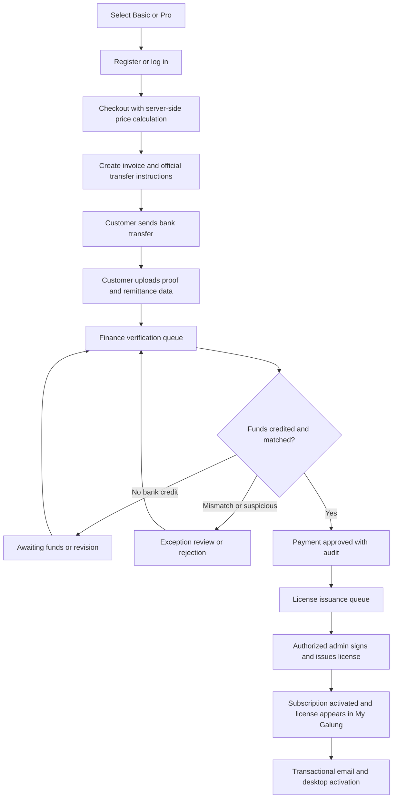
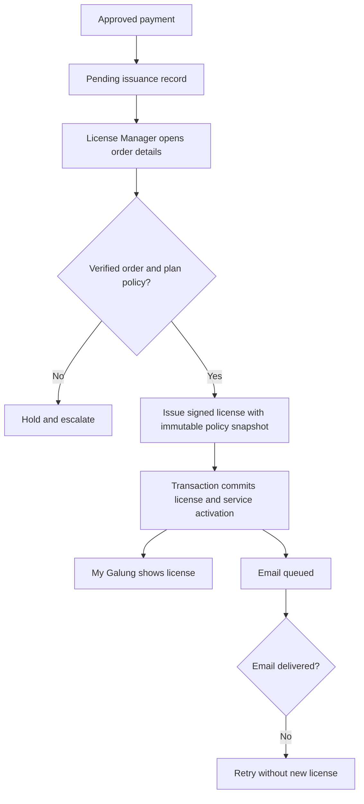

# GALUNG.ID — BUSINESS RULES & USER FLOWS

**ID:** GLG-BRF-001 | **Version:** 1.0 | **Date:** 2026-10-17 | **Status:** Development baseline

## 1. Non-negotiable decisions

- **BR-001:** Basic and Pro are the only purchasable subscriptions in MVP.
- **BR-002:** Domestic and international payment method is manual transfer to a verified company-owned bank account; no payment gateway, card, direct debit or automatic bank verification.
- **BR-003:** Uploading a screenshot or remittance document establishes a claim only. An authorized finance admin must independently confirm actual bank funds received before approving.
- **BR-004:** Payment approval is not license issuance. An authorized license admin explicitly issues license through admin panel, after which dashboard access and email notification become available.
- **BR-005:** Each plan has versioned/configurable device and concurrency limits. Actual numeric limits and feature flags remain TBD until approved.
- **BR-006:** Temporary offline verification lasts max 14 days from the last online server validation, bounded by the earliest authorized entitlement expiration (including grace when allowed); no unlimited offline access.
- **BR-007:** After paid expiration, a 72-hour grace period applies. Access during grace follows last licensed features unless an explicit anti-abuse revocation overrides.
- **BR-008:** Renewal paid/fulfilled before expiry extends from prior paid end. Renewal paid after expiry starts at first point when verification approved and entitlement ready; no backdating to old expiry.
- **BR-009:** Song Library Premium has separate entitlement and will be implemented only after MVP. Organization seat allocation likewise post-MVP.
- **BR-010:** All sensitive changes must carry audit actor/time/reason; never delete bank review history, approved payments, or issued entitlement history.

## 2. Event-time definitions

- `order_created_at`: customer completes checkout and a unique invoice is issued.
- `payment_claimed_at`: customer submits transfer evidence; this is **not** funds receipt.
- `bank_received_at`: funds appear as credited in company records.
- `payment_approved_at`: authorized finance administrator approves after validating bank credit.
- `entitlement_ready_at`: license has been validly issued and can be accessed; `service_start_at = max(payment_approved_at, entitlement_ready_at)` for new and late-renewed subscriptions.
- `paid_end_at`: exclusive expiry instant after monthly/yearly calendar-based period.
- `grace_end_at = paid_end_at + 72 hours` (exclusive).
- `offline_expires_at = min(last_successful_online_check + 14 days, entitlement_authorized_end_at)`.
- Times stored in UTC; show localized absolute date/time with timezone. Billing terms calculated by calendar months/years in the established billing time zone; define behavior for month-end/leap days in tests.

## 3. Canonical payment flow

### 3.1 Transfer instructions on invoice

Required details: order ID, invoice ID, payer identity, product, billing duration, invoice currency, exact amount, due date/timezone, registered beneficiary, bank name, local account or international SWIFT/BIC/IBAN fields as applicable, reference/message to recipient, bank fee responsibility statement, settlement-not-instant warning, support and escalation instructions.

Do not display invented bank addresses/IBAN for Indonesian accounts; collect real account requirements from company bank. Beneficiary changes require privileged multi-person control; invoices keep their historic snapshot.

### 3.2 Customer submits proof

Required fields: payer name, sending bank, sent date, sent amount, sent currency, transfer reference (if supplied), proof JPG/PNG/PDF. Optional notes. Server validates MIME content/size, malware scans, private stores and makes immutable version; `PROOF_SUBMITTED`. Anti-malware scan still pending means admin download/preview unavailable. Resubmission creates a new proof version, not overwrite.

### 3.3 Admin verifies payment

Checklist: invoice exists/is eligible; destination account matches official beneficiary; bank statement/portal confirms completed credit; received amount and currency; bank credit reference unique; remittance costs and exchange differences handled under policy; no prior use; customer and order reconciled. Admin enters reviewer notes and chooses `APPROVE`, `REQUEST_REVISION`, `REJECT`, or specialist exception classification `AWAITING_FUNDS`/`AMOUNT_MISMATCH`. Approval triggers durable outbox and never sends license automatically without subsequent authorized issuance.

### 3.4 International payments

A transfer notice is not bank settlement. Invoice currency should be explicitly supported by beneficiary bank. `sent_amount` can differ from `received_amount`; forex and intermediaries' fees can create shortfall. Finance cannot approve until policy-defined full amount credited. If mismatch, open exception with remedies: customer tops up; company-authorized writeoff/discount handled as a separate recorded adjustment; or refund/manual cancellation subject to company policy. No automatic exchange-rate conversion acceptance. Indicate review may require bank settlement time without promising SLA.

## 4. License issuance flow

License issuance guard: `payment.status=APPROVED`, `license_issue_not_already_complete=true`, valid price/order context, valid policy version, authorized license manager. Issuance is idempotent, including rapid double clicks. Store only hashed/otherwise securely protected activation secrets; signing key must be inaccessible to frontend and desktop.

## 5. Renewal decision table

| Situation | Payment approval | Entitlement ready | New paid period start | Effect |
|---|---|---|---|---|
| Initial purchase | Before first license | After | At readiness | Normal activation |
| Early renewal | Before paid_end | Before paid_end | Prior paid_end | Unused paid period preserved |
| Approval before expiry but issuance delayed until after | Before paid_end | After paid_end | Depends on business policy: do not penalize customer; preserve continuous service if possible | Manual remediation if outage |
| Late renewal within 72h grace | After paid_end | After approval | At readiness | New paid period not backdated; grace bridge remains separate |
| Late renewal after grace | After grace_end | After approval | At readiness | Expired gap unbilled |
| Proof submitted but funds not credited | Any | Not applicable | No new period | Awaiting funds |

**Engineering clarification:** If payment is approved before paid end but issuance completes after paid end, preserve contracted remaining period and ensure the customer is not unfairly disadvantaged by internal delay. Implement as a documented compensating service adjustment, not naive retroactive charge.

## 6. Offline and grace case table

| Case | Last online verification | Paid end | Grace end | Maximum authorized offline end |
|---|---|---|---|---|
| A | Nov 1, 12:00 | Dec 1 | Dec 4 | Nov 15, 12:00 |
| B | Nov 1, 12:00 | Nov 10 | Nov 13 | Nov 13 (if grace-enabled) |
| C | Nov 1, 12:00 | Nov 3 | Nov 6 | Nov 6 |
| D | Nov 1, 12:00 | Already revoked | No grace | Reject next validation; cached revoke limitation acknowledged |

Device clock tampering, restored backups, rollback of local cache and replayed tokens must be included in adversarial tests. Existing valid signed token cannot generally receive instant revocation while truly offline; bound its validity and document trade-off.

## 7. Page-by-page customer journey steps

### 7.1 Pricing page

Inputs: selected monthly/yearly billing. Data: live published Basic/Pro plan pricing, device limit, main features, eligibility, terms. Action: Subscribe. States: loading, no price, unavailable plan, promotion invalid. Clear that Song Library Premium is separate and not purchasable in MVP.

### 7.2 Checkout page

Inputs: billing identity, country, email, company optional, plan term, promo optional, consent to Terms/Privacy and manual bank transfer limitations. Action: Place order. Server returns order and immutable invoice; total, discount, tax presentation, currency and account snapshot. Show price update confirmation if catalog changed during checkout.

### 7.3 Transfer and payment proof page

Show copyable beneficiary/reference and exact total, due date, wire fee instruction, proof upload. Do not claim funds are confirmed after upload. Provide international remittance fields when destination differs. Allow proof amendment under finance workflow.

### 7.4 Status page

Timeline must distinguish order created, proof received, funds in review, approved, pending license, license ready. If revision/rejection, show reason and authorized next step. Never expose reviewer-only bank statement details.

### 7.5 License detail page

Masked key, show/reveal on explicit action, edition, start/end, grace, offline explanation, device list and max, install CTA. On expired/grace show precise timestamps and renew action. Revoked display support path.

## 8. Admin operating procedures

- Finance queue: daily check bank portal/statement directly; never trust screenshot alone; record credit; decision with reason; end-of-day reconciliation of approved payments vs credited entries.
- Licensing queue: inspect pending items; issue license; verify readiness; email failure escalates to notification retry not reissue.
- Support: view redacted state; request proof revision and facilitate manual cases without direct finance approval privileges.
- Content: draft, preview, accessibility review, publish, verify live page.
- Super admin: bank changes require MFA/re-auth and two-person confirmation when configured; notify owners, create audit trail and account revision.
- Release management: installer code signing, checksum verification, release notes, stable channel publication and rollback.

## 9. Exceptional flows

| ID | Situation | Customer-facing response | Operations response |
|---|---|---|---|
| EX-01 | Transfer screenshot falsified | Claim rejected with neutral reason | Preserve evidence and audit, block auto-issuance |
| EX-02 | Amount short after intermediary fee | Awaiting adjustment/verification | Record actual credit; support top-up or approved adjustment |
| EX-03 | Funds arrive after invoice expires | Payment under review, not auto rejected | Reprice/revalidate or refund decision documented |
| EX-04 | Same transfer ref claimed twice | Under review | Confirm bank credit unique fingerprint; avoid double allocation |
| EX-05 | Two admins approve concurrently | One definitive status | Transaction lock/version rejection |
| EX-06 | Payment approved, license signing fails | Payment approved; issuing delayed | Retry issuing only, never reapprove payment |
| EX-07 | License issued, email fails | License available in dashboard | Retry email, incident if repeated |
| EX-08 | Server unavailable during performance | Valid offline token respected | Restore online service; expiry bound remains |
| EX-09 | Customer device limit reached | Show cap and permitted release options | Audit device deactivation |
| EX-10 | Admin accidentally revokes license | Show restricted state / support | Recovery workflow with approval and audit |
| EX-11 | Bank beneficiary changed | Old invoice instructions remain visible with warning if formally replaced | Explicit replacement and customer notification, never silent edit |
| EX-12 | Refund after issuance | Transparent adjusted status | Refund approval + revised entitlement according to legal policy |

## 10. Out-of-MVP future-proofing

Create product/entitlement references general enough for Song Library subscription and institution seats, but **do not grant access** to Song Library Premium based on Basic or Pro. Songs free vs premium, organization-level subscribed Song Library with allocated operator/teacher seats, participant projection viewers not individually subscribed. Implement these in later releases after separate product specification and rights review.

## 11. Policy decisions to be signed by owner prior to production

Actual prices, device limit per edition, simultaneous sessions, feature entitlements, bank beneficiary account details, accepted invoice currency, handling FX/bank fees and underpayments, proof upload limit, payment review SLA, refund policy, taxes, windows signing provider, emergency revoke policy, license key delivery wording, privacy retention periods, transactional email sender domain. Anything listed must never be silently defaulted by a developer.
