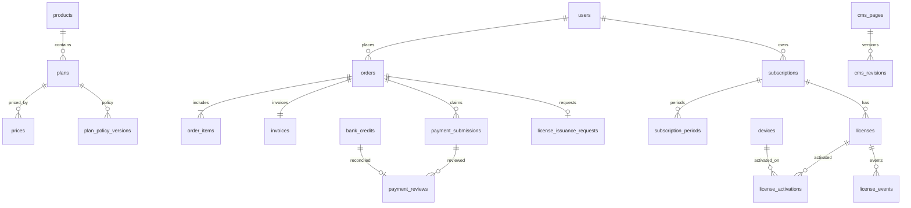

# GALUNG.ID — DATABASE SCHEMA SPECIFICATION

**Document:** GLG-DBS-001 · **Version:** 1.0 · **Date:** 2026-10-17 · **Status:** Engineering design / review required  
**Target:** PostgreSQL 16+ · **Owner:** Product + Backend Engineering · **Companion:** `001_core_schema.sql`, `002_future_extensions.sql`, `DATABASE_VALIDATION_CHECKLIST.md`  
**Scope:** Public website, My Galung, admin, domestic/international manual transfers, Basic/Pro subscriptions, license issuance, desktop verification, CMS.

> The SQL is a **reference starting schema**, not a production-ready migration. `003_phase00_contract_delta.sql` is an additive Phase 00 review draft after `001_core_schema.sql`; `002_future_extensions.sql` remains excluded from MVP. Production PostgreSQL 16 migration execution, provider compatibility, security controls, concurrency and regression tests remain required before deployment. Never insert demonstration amounts, bank accounts, or secrets in production seeds.

## 1. Binding decisions

| ID | Requirement | Persistence / invariant |
|---|---|---|
| DEC-001 | Device/concurrency limits configurable per Basic/Pro plan | `plan_policy_versions`; immutable license snapshot; activation count checked transactionally |
| DEC-002 | Temporary offline access max 14 days | `offline_max_hours<=336`; `license_activations.last_online_validated_at`, `offline_token_expires_at`; signed token validity bounded by entitlement/grace |
| DEC-003 | Grace period exactly 72 hours | `subscriptions.current_grace_end_at`, validated `subscription_periods.grace_end_at`; expiry is exclusive instant |
| DEC-004 | Late renewal from verified payment + entitlement ready | `payment_approved_at`, `entitlement_ready_at`, `start_at`, `paid_end_at`; no backdating; early renewal starts at old paid end |
| DEC-005 | International customers via manually verified bank transfer | country, invoice currency, payer-sent amount/currency, reconciled bank credit, approval record; never infer bank settlement from proof |
| DEC-006 | Commercial MVP sells Basic & Pro only | product/plan seeds and API gating; post-MVP catalog extensions separate |

**Never conflate:** `order_status`, `payment_status`, `subscription_status`, `license_issuance_status`, `license_status`. Every transition is separately attributable.

## 2. Architectural conventions

- PostgreSQL schema namespace `galung`; lower-case `snake_case`; plural table names; UUID primary keys (except append-only high-throughput audit ID).
- Persist all instants as `timestamptz` (UTC instants). Render with user/company timezone; store time-zone *identity* only for presentation. Subscription duration is fixed elapsed UTC time: 30 × 24 hours or 365 × 24 hours.
- Financial amounts: signed 64-bit integer **minor currency units** with ISO-4217 currency code. Currency-specific exponent comes from versioned application currency metadata (IDR typically exponent zero in user-facing payment workflows; don't assume all currencies use 2 decimals). Immutable invoices include finalized amount snapshots. Never use float for money.
- Prefer immutable ledger/event history and explicit reversal/correction records for approved transactions. Avoid overwriting accepted financial evidence.
- All file bodies in private object storage, only metadata and object pointers in PostgreSQL. Installer objects are **not** subject to 5MB proof-upload cap; constrain proof assets specifically in application validation.
- Application account uses least-privilege DB roles; migrations use separate restricted deployment credentials. Sensitive bank numbers encrypted at application/KMS layer, with redacted audit logs.
- Database checks enforce local invariants; cross-row, cross-table, privileged transitions and role permissions require service transactions, row-level locks, explicit idempotency keys, and tests. Referential integrity alone is insufficient.
- Publish currency-specific bank account and bank instructions only after bank verification and privileged approval. Invoice preserves immutable bank-instruction snapshot.

## 3. High-level entity relationships

## 4. Detailed table catalog — Release 1

**Identity, administration and access**

| Table | Primary / unique keys | Main columns | Notes |
|---|---|---|---|
| `users` | `id`; `lower(email)` unique | email, display_name, password_hash, verified_at, country, locale, status | No plain passwords. Make email normalization consistent. |
| `roles` | id, unique code | code, description | Seed super_admin, finance_admin, license_manager, content_manager, support_agent, analyst. |
| `permissions` | id, unique code | code, description | Separate finance.approve, license.issue, bank.change, cms.publish, etc. |
| `role_permissions` | composite PK | role_id, permission_id | Role-permission join. |
| `user_roles` | composite PK | user_id, role_id, actor/time | Staff role grants audited. |
| `auth_sessions` | id, token hash unique | user_id, expiry, revoked_at | Secure session token hashed before storage. Multi-factor factors/recovery will require vetted identity-provider tables or further migrations. |

**Product, pricing and catalog**

| Table | Keys | Main columns / requirements |
|---|---|---|
| `products` | id, code unique | Galung Suite as product in MVP |
| `plans` | id, code unique | Basic/Pro, product_id, status |
| `plan_policy_versions` | id; (plan_id,version) unique | max_devices, max_concurrent_sessions, offline_max_hours<=336, grace_hours=72, JSON entitlement, validity window |
| `prices` | id; (plan_id,term_days,currency,version) unique | 30 or 365 elapsed days; amount_minor; effective interval; archived historical versions |
| `promotions` | id, code unique | fixed/percent, expiry, caps, status |
| `promotion_plan_scopes` | composite | Which plans eligible |
| `promotion_redemptions` | id; (promotion_id,order_id) unique | Discounts actually used; max redemption/per-user caps require atomic checks under contention |

**Payment, invoicing and bank reconciliation**

| Table | Keys | Main columns / requirements |
|---|---|---|
| `bank_accounts` | id | encrypted account, last4, bank, beneficiary, BIC, optional IBAN, country, supported currency, approval |
| `bank_account_change_requests` | id | old/proposed account, requestor/reviewer, reason, state; reject same-person review |
| `orders` | id, order_number unique | customer, kind, status, international billing, invoice currency, subtotal/discount/tax/total snapshots, due_at |
| `order_items` | id | plan, price, policy-version FK + immutable JSON snapshots; MVP one individual license per item |
| `invoices` | id, order_id unique, number unique | monetary snapshot, bank_account FK + bank_instructions_snapshot, pdf pointer |
| `file_assets` | id, storage_key unique | private storage metadata, hash, scan_status, owner; generic object metadata |
| `payment_submissions` | id, (order_id,revision_number) unique | proof_asset FK, payer, remittance reference, sent amount/currency/date, status |
| `bank_credits` | id, (bank_account_id,bank_reference) unique | funds actually credited, amount/currency/received_at; entered after independent bank verification |
| `payment_reviews` | id, unique approved bank_credit_id | submission, reviewer, decision, bank credit, reason; approvals **require** actual bank credit reference |

**Subscription, licensing and desktop devices**

| Table | Keys | Main columns / requirements |
|---|---|---|
| `subscriptions` | id | customer, plan, status, current_paid_end_at, current_grace_end_at |
| `subscription_periods` | id, source_order_id unique | payment approved timestamp, entitlement ready timestamp, start/end, checked 72h grace end |
| `license_issuance_requests` | id, order_id unique | order, subscription, request state, authorized issuing actor, failure reason |
| `licenses` | id, public ID unique, issuance FK unique | policy version snapshot, hash of activation secret, device/concurrency limits, feature snapshot, issue/revoke events |
| `devices` | id, (owner_id,fingerprint_hash) unique | masked label and opaque hashed fingerprint; minimize tracking identifiers |
| `license_activations` | id, (license_id,device_id) unique | activation, last online check, offline expiry, deactivation |
| `license_events` | id | event type, actor/device context, timestamp, redacted metadata; append-only |

**CMS, downloads, events and audit**

| Table | Keys | Purpose |
|---|---|---|
| `cms_pages` | (slug,locale) unique | Marketing and legal page states |
| `cms_revisions` | (page_id,revision) unique | Immutable versioned JSON content and SEO metadata |
| `portfolio_items` | (slug,locale) unique | Public portfolio/case studies |
| `software_releases` | (version,channel,platform) unique | Installer object/hash, notes, publishing |
| `notifications` | id | In-app notices and read status |
| `email_deliveries` | id | Retries / email status, never licensing source of truth |
| `outbox_events` | id | Transactional outbox for reliable async work |
| `audit_logs` | bigint identity | Sensitive actor/entity/reason/change; redacted metadata, append-only |
| `idempotency_keys` | (scope,key) unique | Duplicate-request prevention; body hash, stored result and expiry |

## 5. Critical transaction boundaries

### 5.1 Order creation

Serializable / appropriately locked transaction: validate published plan, billing cycle, policy and price effective at checkout; recompute discount/tax; select approved beneficiary account that supports invoice currency; snapshot price/policy/bank details; insert order, item(s), invoice and redemption atomically; commit; enqueue invoice notification via outbox. Return idempotent order for duplicate checkout request. **Do not store bank account plaintext in audit metadata.**

### 5.2 Proof submission

Authorize owner; validate order eligibility, file type/actual content and proof-specific 5MB limit, malware result (`clean`) before finance preview; insert revision and payment status. Proof upload never changes subscription or license state. Customer may resubmit; old versions remain.

### 5.3 Finance approval

Transaction: lock order and submission; ensure admin has finance permission; ensure bank credit exists, belongs to invoice's bank account, matches amount/currency or authorized adjustment, has not previously approved another payment; insert `payment_reviews(decision='approved',bank_credit_id=...)`; set order `approved`; create pending license issuance request if absent; append audit and outbox event. **No automatic license issue in this transaction.** Use unique bank-credit approval index and idempotency key. International remittance may have differing sender/receiver amounts; amounts are never silently converted to invoice value.

### 5.4 Explicit license issuance by admin

Lock issuance request/order/subscription, verify finance-approved order and policy snapshot, authorized license manager; create signed credentials via protected signing service; persist license and immutable policy; create/extend paid service period; mark request issued and order fulfilled; store audit and notification outbox in one DB transaction. Signing-service failure should leave recoverable pending/failed state, with no misleading license-issued event. If sign-before-commit is required, make signing operation idempotent by request ID and securely discard orphaned token outputs.

### 5.5 Renewal and calendar arithmetic

- `paid_end_at` is exclusive. Grace is `[paid_end_at, paid_end_at+72h)`.
- Initial or **late** renewal: `start_at = greatest(payment_approved_at, entitlement_ready_at)`; period end is `start_at + term_days × 24 hours` in elapsed UTC time; `term_days` is 30 or 365.
- Early renewal: if payment and entitlement are ready before previous paid_end, `start_at = previous paid_end`; retain unused paid period.
- If payment approved before paid_end but license issuance is delayed beyond expiry because of Galung operational failure, preserve customer's contracted service via compensating adjustments and audit; no silent loss.
- A paid subscription and license could be active while a future renewal order is pending: never downgrade it merely because renewal proof was rejected.
- A grace window is not itself a paid subscription period and should not be double-counted.

### 5.6 Desktop online and offline validation

In a locked transaction, enforce active devices against snapshot `max_devices`. `offline_token_expires_at = least(last_online_validated_at+interval '14 days', authorized_access_end_at)` and sign expiry into token; if revoked/disabled when online, deny. Concurrency limit is separate from device count; add server-controlled leases/heartbeats if truly enforcing simultaneous use (not yet modeled in base DDL). A signed token cannot be instantly revoked on a fully disconnected device; mitigate with bounded validity and audit. Handle clock rollback with signed time claims, monotonic clock checks where available, and tests.

## 6. Integrity constraints and gaps requiring production engineering

1. **Active price intervals:** DDL ensures a per-version uniqueness but not non-overlapping published price windows. Introduce an exclusion constraint (`btree_gist`) or publish-time serializable validation to prevent two current published prices for same plan/term/currency.
2. **Policy versions:** similarly prevent overlapping approved/effective policy intervals; store policy snapshot on order item and license.
3. **One order item per individual checkout:** enforced at service boundary for MVP; add order-level unique index if decided permanently. Future institutional quantities will change this rule.
4. **Payment approval reconciliation:** DB uniqueness prevents duplicate use of one bank credit, but partial/combined payments need separate allocation ledger before they can be supported. MVP must explicitly reject/handle them as manual exception, not pretend schema fully supports allocation.
5. **Subscription periods:** service must prevent overlapping or duplicated periods for same subscription via lock or exclusion constraint; current SQL does not impose overlap exclusion. Period creation needs idempotency and unique source order.
6. **State transitions:** DDL enums define possible states, not allowed transition graphs. Implement central transition services, strict role checks, append-only status/event history.
7. **Approval immutability:** forbid UPDATE/DELETE to `payment_reviews`, `bank_credits`, `subscription_periods`, `license_events`, `audit_logs`, and historical invoices after issuance using privilege grants and/or triggers; corrections are compensating entries.
8. **Cross-entity ownership:** assert order belongs to authenticated user; matched subscription, license and device share allowed customer ownership; FK alone does not prove same owner.
9. **Files:** `file_assets` generic object metadata supports installer files >5MB. Proofs must be <=5MB and clean before use; installer bundles require SHA-256 and secure code signing.
10. **MFA and login provider:** standard OIDC/auth adapter tables are intentionally not fixed until provider selection; never design hand-made insecure password reset flows.
11. **Audit retention:** GDPR/PDP and financial retention periods require legal approval; audit logs must redact secrets and payment document contents.
12. **Country and currency metadata:** ISO codes should be checked against approved reference tables / service validation, not merely CHAR(2)/CHAR(3).
13. **Review idempotency:** index `bank_credit_id` where decision approved plus locked transitions prevents a credit being used twice; cross-check exact bank-account match in service transaction.
14. **Referential ordering:** DB migration deploys `subscriptions` before related `orders` FK addition. Production migration framework should arrange table creation in explicit dependency order.
15. **Operational outbox:** workers require locking (`FOR UPDATE SKIP LOCKED`), retry backoff and dead-letter recovery; do not assume `processed_at` alone solves concurrency.

## 7. Indexing & performance plan

- Primary queries indexed: customer orders by created date, payment queue by status/date, subscription by customer, license by subscription, active license activations, outbox pending, notifications by customer/date, audit by entity/date.
- At scale, add `(customer_id,status,created_at)` partial indexes based on measured queries; avoid speculative indexes on low-volume tables.
- Use cursor pagination for audit/notifications, not unlimited OFFSET scans.
- Analyze SQL plans with representative production-like synthetic fixtures; watch write amplification on payments and audit.
- Consider time partitions for immutable logs **only after** measured volume justifies operational complexity.

## 8. Data classification, privacy, and retention

| Class | Examples | Storage/access rules |
|---|---|---|
| Public | Product description, published pricing, portfolio | Read public; writes via CMS RBAC |
| Customer PII | Email, names, country, billing address | Need-to-know roles; backups encrypted |
| Highly sensitive | Bank account details, proof file, receipt references | KMS encryption / private storage; finance-only; signed access URLs short lived |
| Security secret | Password hash, activation hash, auth session token hash, signing key | Signing **private** key never in DB/client; hash token; strict privilege |
| Financial historic | Approved payment review, bank credit, invoice | Append-only and auditable; legal retention |
| Device | Fingerprint hash / device status | Minimize and disclose in privacy terms |

Account deletion requests must be balanced with lawful financial record preservation; use pseudonymization where deletion cannot legally occur, preserving auditability.

## 9. Deployment & migrations

1. Create migrations against new staging DB; run in CI with rollback simulation and a PostgreSQL 16+ instance.
2. Seed roles/permissions and products Basic/Pro only; create policy versions with **approved numeric limits**, never fabricated defaults in production.
3. Import approved bank configurations via secure admin-only workflow; do not hardcode beneficiary values in SQL.
4. Use expand-and-contract migrations, backward-compatible changes first; lock review for high-volume altering columns.
5. Run migration under deployment identity, then app identity with restricted grants. Verify environment secrets and RLS/tenant boundaries if multi-tenancy is introduced.
6. Conduct backup/point-in-time restore drill and reconcile number of approved payments and issued licenses.
7. Include runbooks for migration failure, reference data rollback, and finance-event reconciliation.

## 10. Release 2+ extension boundaries

`002_future_extensions.sql` is **conceptual only** and not intended to be deployed with the MVP. Song Library Premium is a separate paid product with its own entitlement and content rights. Institutional licensing needs organizations, seat pools and assignments; a viewer watching projected guidance does not need a Song Library seat. Avoid auto-enabling these modules in MVP.

## 11. Engineering acceptance gates

### Phase 00 reconciliation draft, pending approval

`003_phase00_contract_delta.sql` proposes legal acceptance evidence, finance/bank maker-checker structures, non-overlapping prices/policies/paid periods, license revisions, entitlement events, one-use activation claims, challenges, device keys, rotating refresh credentials, public signing-key registry and per-device token issuance. The existing `001_core_schema.sql` is preserved; additive backfill and old-column retirement require separate reviewed production migrations. The draft is paired with `galung_api_v1/openapi.yaml` 1.1.0-draft.1 and the revised licensing protocol. No real plan, currency, bank or tax values are seeded. The Product Owner approved two different MFA-verified actors for beneficiary changes; Finance/Security operational details and all other commercial values remain TBD.

A database schema is accepted only when:

- Core DDL runs cleanly against target PostgreSQL and migrations can run from an empty DB.
- Test fixtures show only Basic and Pro purchaseable.
- Proof alone cannot produce approved payment or issued license.
- Duplicate bank credit use and duplicate issuance attempt are rejected/idempotent.
- International payments preserve sent and received currencies and support mismatch review.
- Early and late renewal periods have correct start/end and exactly 72h grace.
- Offline issuance expires no later than 336h from last online check and authorized access end.
- Device limit varies by policy version and is enforced transactionally under concurrent activations.
- Access-control tests deny cross-customer data and unauthorized finance/license operations.
- Outbox retries never duplicate licensed service periods.
- Backups restore, application scans are clean, and sensitive fields are absent from public logs.

See `DATABASE_VALIDATION_CHECKLIST.md` for execution checklist and test cases.
